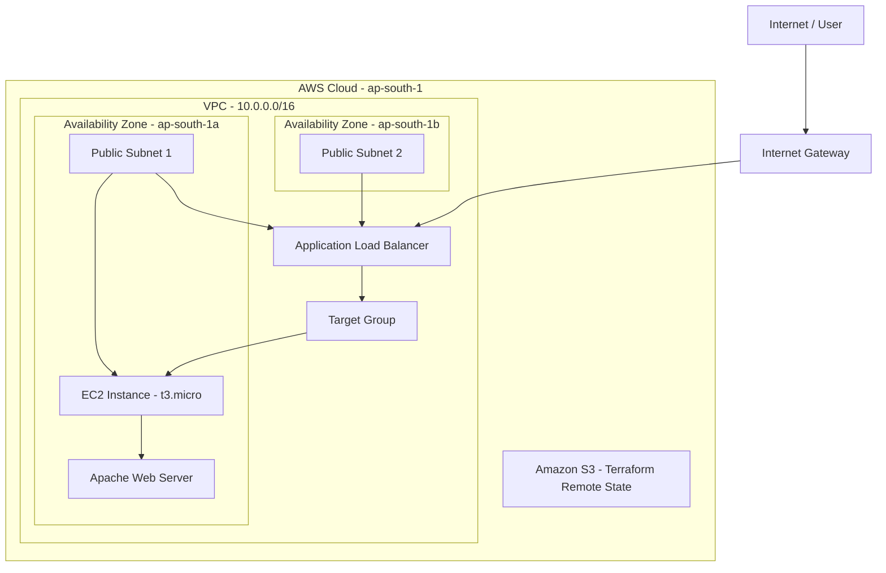

# Terraform AWS DevOps Infrastructure

## Project Overview

This project demonstrates how to provision AWS infrastructure using Terraform with a modular and reusable approach.

The infrastructure includes an AWS VPC, two public subnets across two Availability Zones, Security Groups, an EC2 instance, and an Application Load Balancer.

The application was successfully deployed and accessed through the ALB DNS name.

## Architecture



**Note:** The ALB is deployed across two public subnets. The EC2 instance is deployed in one public subnet. S3 stores Terraform remote state separately from application traffic.

## AWS Services Used

- Amazon VPC
- Amazon EC2
- Application Load Balancer (ALB)
- Target Groups
- Security Groups
- Internet Gateway
- Amazon S3 (Terraform Remote State)

## Tools & Technologies

- Terraform
- AWS
- Git
- GitHub
- Linux
- Apache Web Server

## Key Features

- Modular Terraform architecture.
- Separate Dev and Prod environment configurations.
- Reusable Terraform modules.
- S3 remote backend for Terraform state.
- State locking using S3 lockfile.
- Dynamic Security Group rules.
- ALB integration with EC2.
- Infrastructure provisioning and cleanup using Terraform.

## Project Structure

```text
jenkins-aws-ecs-cicd/
│
├── backend-bootstrap/
│   ├── main.tf
│   └── provider.tf
│
├── environments/
│   ├── dev/
│   └── prod/
│
├── modules/
│   ├── alb/
│   ├── ec2/
│   ├── security-group/
│   ├── subnet/
│   └── vpc/
│
├── templates/
│   └── install_apache.sh
│
├── main.tf
├── provider.tf
├── variables.tf
├── outputs.tf
├── versions.tf
├── terraform.tfvars.example
├── .gitignore
└── README.md
```

## Deployment

1. Configure AWS CLI credentials.
2. Initialize and deploy the backend bootstrap configuration.
3. Configure environment variables using `terraform.tfvars`.
4. Initialize Terraform.
5. Validate the configuration.
6. Review the execution plan.
7. Apply the infrastructure.
8. Access the application using the ALB DNS output.

Example commands:

```bash
terraform init
terraform fmt -recursive
terraform validate
terraform plan -var-file="environments/dev/terraform.tfvars"
terraform apply -var-file="environments/dev/terraform.tfvars"
```

## Cleanup

To remove the provisioned infrastructure:

```bash
terraform destroy -var-file="environments/dev/terraform.tfvars"
```

**Note:** The S3 remote state bucket is managed separately and is not deleted by the main infrastructure destroy command.

## Screenshots

Project screenshots will be added here.

## Security Considerations

- AWS credentials are not stored in the repository.
- Terraform state files are excluded using `.gitignore`.
- Environment-specific `.tfvars` files are excluded.
- SSH access should be restricted to the user's current public IP.
- The ALB currently uses HTTP. HTTPS requires an ACM certificate and an HTTPS listener.


## Screenshots

Project screenshots will be added here.
## Screenshots

### 1. Application Running Through ALB


### 2. Terraform Infrastructure Deployment


### 3. Terraform Resources


### 4. VPC and Subnets


### 5. EC2 Instance


### 6. Application Load Balancer


### 7. Terraform Destroy


## Author

Amit Kumar Maurya

GitHub:https://github.com/AMITMAURYA321/terraform-aws-devops
